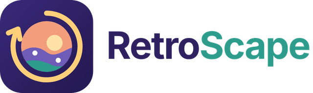

<p align="center"></p>

PWA para retrospectivas ágiles. En lugar de llenar tarjetas, cada miembro coloca su avatar en un **paisaje compartido** (cima, valle o tormenta) según cómo vivió el sprint, deja **comentarios anónimos por voz o texto** y el equipo **vota con fichas** las acciones que adopta como misiones. La IA se encarga del trabajo pesado: cuida el anonimato antes de publicar, agrupa los comentarios, revisa si las misiones del sprint anterior funcionaron, redacta el acta y acompaña al facilitador por voz.

Proyecto del curso CC451 Interacción Humano Computadora, Universidad Nacional de Ingeniería, 2026-2. Docente: Ciro Núñez Iturri.

## Equipo

| Integrante | Caso de uso rediseñado | Automatización con IA |
|---|---|---|
| Isaac Antonio Martel Balvin | CU-02 Expresar cómo viví el sprint | Eco, asistente de voz en modo sala |
| Diego Alesxander Orrego Torrejon | CU-03 Aportar un comentario anónimo | Guardián del anonimato |
| Sebastián Enrique Huaypar Acurio | CU-04 Analizar los comentarios con el LLM | Análisis trazable y acta del sprint |
| Bryan Aldrin Chontay Campos | CU-05 Votar y registrar acciones | Continuidad: seguimiento de misiones y temas que vuelven |

El detalle de cada automatización, por qué necesita IA y qué decide siempre una persona está en [docs/ia.md](docs/ia.md).

## Estado del proyecto

Avance para la Práctica Calificada 03 (noviembre de 2026). Funciona de punta a punta: salas en tiempo real, colocación privada y revelación anónima, comentarios por voz o texto con revisión del guardián, análisis con LLM revisable por quien facilita, votación con fichas, acta, seguimiento de misiones entre sprints, Eco, vista para el proyector y evolución del equipo. Las cuatro automatizaciones están implementadas y probadas con Groq; el adaptador de Gemini es intercambiable desde `.env`.

Pendiente para la entrega final:

- Evaluación de usabilidad con usuarios reales y los ajustes que resulten.
- Publicación con HTTPS, necesaria para el dictado por voz y la instalación de la PWA en celulares.
- Arrastre del avatar sobre el paisaje (hoy se coloca tocando una zona, con botones o con el teclado).
- Ajuste fino de los prompts con el proveedor real y más pruebas de la voz de Eco en el proyector.

## Cómo correrlo

Requiere Node.js 18.17 o superior. No hay dependencias que instalar.

```bash
git clone https://github.com/SL7u777/RetroScape_App.git
cd RetroScape_App
cp .env.example .env      # pega tu clave de Gemini (Google AI Studio) o de Groq
npm start
```

Abre `http://localhost:5173`. La consola también muestra la dirección para entrar desde otros dispositivos de la misma red. Sin clave, la app funciona con **IA simulada** (reglas locales, solo para pruebas) y lo indica en pantalla.

Para una demostración sin público, crea una sala y une a un equipo simulado de 5 personas:

```bash
npm run equipo-simulado -- RS-1234
```

Pruebas automáticas: `npm test`. Guía completa en [docs/instalacion.md](docs/instalacion.md).

## Cómo responde el diseño a los requisitos del curso

| Requisito | Solución |
|---|---|
| Interfaz no convencional | Paisaje con tres zonas en lugar de columnas de tarjetas; el cielo cambia según el clima del equipo al revelar |
| Voz | Dictado de comentarios con transcripción editable, lectura en voz alta y Eco, asistente de voz del facilitador |
| LLM con capa de abstracción | Adaptadores intercambiables para Gemini, Groq y uno simulado para pruebas, con validación de cada respuesta |
| PWA | Instalable, con manifiesto, service worker y fuentes propias; carga sin conexión |
| Personalización continua | Perfil local con preferencias, tiempo de espera del dictado que se ajusta con el uso, emociones confirmadas y posición del sprint anterior |
| Multiusuario | Salas con código, sincronización en tiempo real, vista separada para el proyector y votación conjunta |
| Diseño emocional (Norman) | Visceral: paisaje, cuenta regresiva y estandartes. Conductual: colocación, dictado y fichas con respuesta inmediata. Reflexivo: evolución entre sprints y seguimiento de misiones |

## Contenido

```
server/                 Servidor Node.js sin dependencias
  index.js              API REST, archivos estáticos y arranque
  salas.js              Fases de la retro, reglas de privacidad, votación y Eco
  eventos.js            Tiempo real con Server-Sent Events, una vista por rol
  store.js              Persistencia en data/retroscape.json
  ia/                   Capa de IA: gateway, proveedores y las cuatro automatizaciones
public/                 PWA (HTML, CSS y módulos de JavaScript)
  js/vistas/            Inicio, sala, miembro, facilitador, Eco, proyector, evolución y preferencias
  marca/                Logo e ícono en SVG y PNG
scripts/                Equipo simulado para demostraciones
test/                   Pruebas automáticas (node --test)
data/mock/sprints.json  Historial de ejemplo del Equipo Atlas (sprints 11 a 14)
docs/
  ia.md                 Automatizaciones con IA
  arquitectura.md       Arquitectura C4 y decisiones
  instalacion.md        Instalación, demostración y solución de problemas
  requerimientos.md     Requerimientos, historias de usuario y trazabilidad
  diagramas/            C4, interacciones y Gantt
```

Otros enlaces: [prototipo en Figma](https://www.figma.com/design/BZ1cMfDsXeL8udWJO67UBA/RetroScape).

## Licencia

[MIT](LICENSE). Las fuentes Inter y Bricolage Grotesque se distribuyen con licencia SIL Open Font License (`public/fuentes/`).
