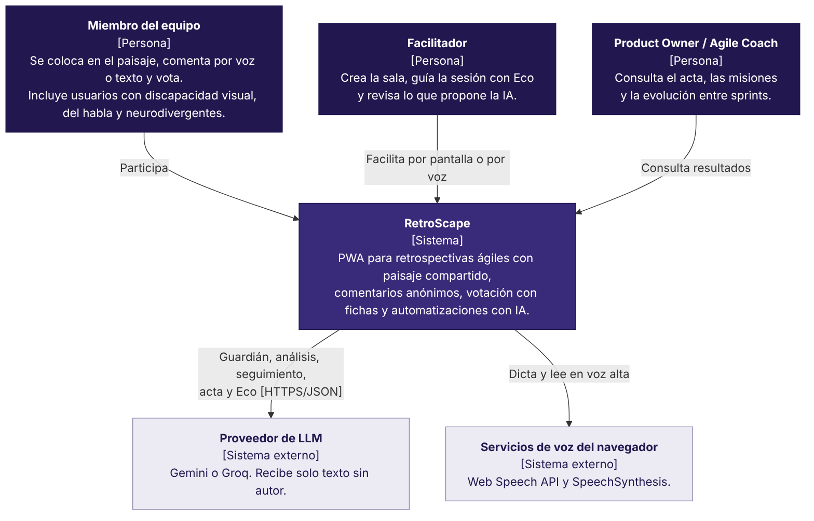
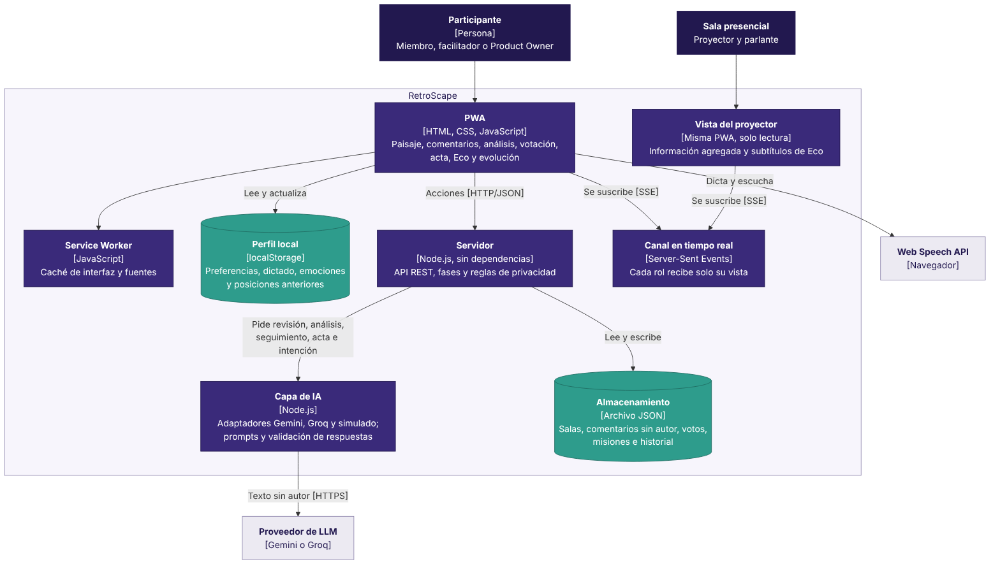

# Arquitectura

Arquitectura implementada, documentada con el modelo C4. Las fuentes de los diagramas están en `docs/diagramas/` en formato Mermaid (GitHub las muestra directamente) y se exportan a PNG con:

```bash
npx -p @mermaid-js/mermaid-cli mmdc -i docs/diagramas/c4-contexto.mmd -o docs/diagramas/c4-contexto.png -s 2
```

## Nivel 1: contexto



RetroScape lo usan los miembros del equipo (incluidos usuarios con discapacidad visual, del habla y neurodivergentes), el facilitador y el Product Owner o Agile Coach. Depende de dos servicios externos: un proveedor de LLM (Gemini o Groq) y los servicios de voz del navegador.

## Nivel 2: contenedores



| Contenedor | Tecnología | Responsabilidad |
|---|---|---|
| PWA | HTML, CSS y módulos de JavaScript | Paisaje, comentarios, análisis, votación, acta, Eco, evolución y preferencias |
| Vista del proyector | La misma PWA, en modo solo lectura | Información agregada para la sala y subtítulos de Eco |
| Service Worker | JavaScript | Caché de la interfaz, el logo y las fuentes para cargar rápido y sin conexión |
| Perfil local | localStorage | Preferencias, tiempo de espera del dictado, emociones confirmadas y posiciones anteriores, sin cuenta |
| Servidor | Node.js, sin dependencias | API REST, fases de la retro, reglas de privacidad y confirmaciones |
| Canal en tiempo real | Server-Sent Events | Envía a cada conexión solo la vista que le corresponde a su rol |
| Capa de IA | Node.js | Prompts, adaptadores de proveedores y validación de respuestas |
| Almacenamiento | Archivo JSON | Salas, comentarios sin autor, votos, misiones e historial del equipo |

## Decisiones

1. **Un servidor propio en lugar de Supabase.** La PC2 planteaba Supabase para la base de datos y el tiempo real. Se reemplazó por un servidor Node.js sin dependencias para que la app corra con `npm start`, sin cuentas externas ni conexión a internet salvo para el LLM, y para que la demostración en la expo funcione en una red local.
2. **El servidor arma una vista por rol.** Cada miembro, el facilitador y el proyector reciben un objeto distinto (`vista()` en `server/salas.js`). Antes de la revelación, nadie recibe la posición de otro, ni siquiera el facilitador; el borrador del análisis solo llega al facilitador. La privacidad no depende de lo que la interfaz decida ocultar.
3. **Los comentarios no guardan autor.** No se guarda quién lo escribió, ni la hora exacta, ni el orden de llegada (se muestran en un orden aleatorio fijo). El audio del dictado lo procesa el navegador y RetroScape nunca lo recibe.
4. **El navegador nunca llama al LLM.** Lo hace el servidor, que guarda las claves (RNF-08) y envía solo texto sin autor (RNF-07). El nombre de quien escribe un comentario se revisa con reglas y nunca viaja al LLM junto con su texto.
5. **La IA interpreta; el sistema decide.** Las respuestas del modelo pasan por una validación que descarta temas sin comentarios reales, identificadores inventados y acciones fuera de la fase. Las confirmaciones de Eco las calcula el servidor con sus propios datos.
6. **El proveedor simulado es solo para pruebas.** Si el LLM real falla, la app no lo reemplaza con el simulado: avisa y ofrece reintentar, agrupar a mano o continuar sin esa ayuda.
7. **Server-Sent Events en lugar de WebSocket.** El tiempo real va del servidor a los clientes; las acciones viajan por HTTP. SSE se reconecta solo (RNF-06) y no necesita librerías.
8. **El perfil vive en el dispositivo.** Se entra sin cuenta, así que la personalización continua se guarda en el navegador y se puede borrar desde Preferencias.
9. **Mínimo de 3 personas para la revelación automática.** Con menos, las posiciones se podrían deducir. El facilitador puede revelar antes, pero el sistema se lo advierte, y las razones marcadas solo se muestran desde 3 participantes.

## Flujo de una sala

```
Colocación privada ──► Revelación (cuenta regresiva) ──► Comentarios anónimos
        │                                                   │ guardián del anonimato
        ▼                                                   ▼
  posición anterior                               Análisis con IA (borrador privado)
  y misiones previas                               temas, continuidad y edición
                                                            │
                                                            ▼
              Evolución del equipo ◄── Acta con IA ◄── Votación con fichas
```

Eco puede disparar las transiciones de fase por voz; los botones de la pantalla hacen lo mismo.
